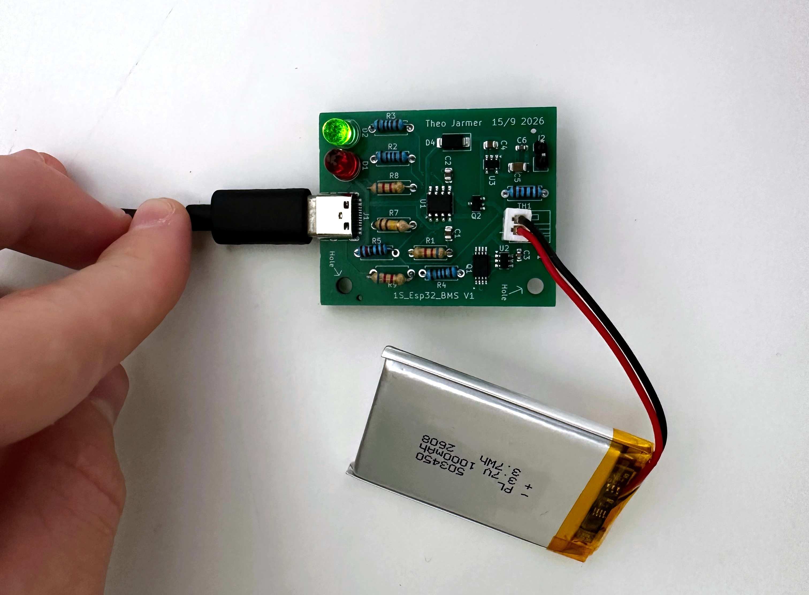
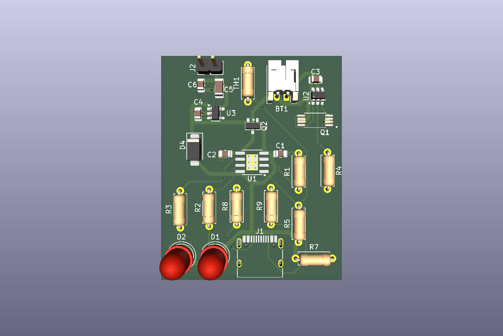

# ESP32 1S Li-ion BMS & Power Board

2-layer KiCad PCB that charges and protects a single Li-ion cell and
provides a regulated 3.3V rail for an ESP32.

## Features
- USB-C input, charging via TP4056 (R_PROG = 2 kOhm, about 600 mA from the datasheet formula, not measured)
- Cell protection (DW01A + FS8205A)
- Automatic USB/battery power-path switching (P-MOSFET Q2 + Schottky D4)
- 3.3V regulation (AP2112K-3.3)

## Power path
USB power feeds the 3.3V regulator through Schottky diode D4, and P-channel
MOSFET Q2 (gate tied to VBUS) connects the battery to the same node only when
USB is absent. D4 blocks current flowing back to the USB port.

## Testing done
- 3.3V output from USB power
- 3.3V output from battery power
- 3.3V output maintained when switching between USB and battery (unplugging each at different times)
- Battery charging

## Not tested
- Operation with an ESP32 connected
- Measured charge current
- Protection cutoffs (overcurrent, over-discharge, short circuit)
- Temperature sensing (TH1 replaced by a fixed 10 kOhm resistor on the built board)

## Files
- hardware/: KiCad project
- manufacturing/: gerbers, bom.csv, jlcpcb_order_bom.csv, placement file
- docs/: schematic PDF
- img/: photos and PCB render

## Build
5 boards fabricated by JLCPCB (SMD parts assembled by JLCPCB, through-hole parts hand-soldered).
Designed and simulated in KiCad 10.0.

## License
MIT
